<p align="center">
  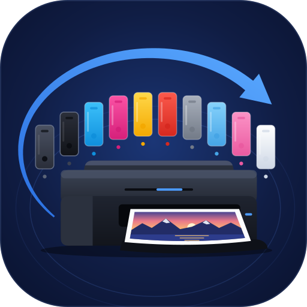
</p>

<h1 align="center">Printmich</h1>

<p align="center">
  A photo of the day, week or month, printed from your <a href="https://immich.app">Immich</a> library on a Canon imagePROGRAF PRO-310.<br>
  Self-hosted, driverless, and built for Unraid.
</p>

<p align="center">
  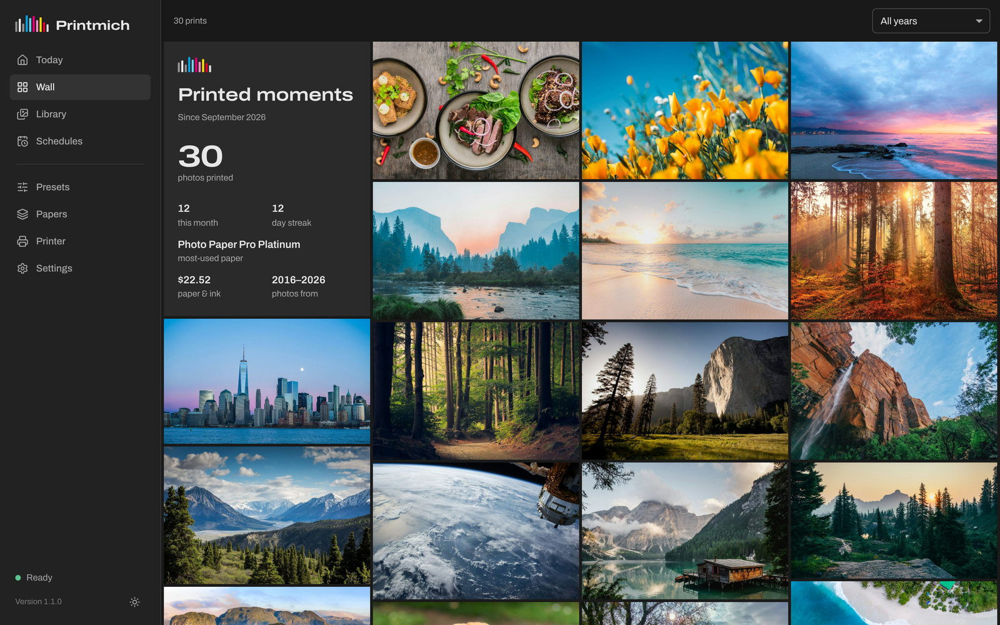
</p>

Printmich picks a photo from your favorites, albums, people, tags, star ratings or "on this day", lays it out on the paper you have loaded, color-manages it, and sends it straight to the printer over the network. No driver, no computer left on, no CUPS. Everything it prints lands on a photo wall you can browse later.

It talks to the PRO-310 the way AirPrint does (IPP Everywhere), so it also works with most other modern network photo printers.

## Highlights

- **Schedules you control.** Daily, weekly on chosen days, monthly, every few days, or any cron expression, in your time zone. Each schedule mixes photo sources with weights, so "mostly favorites, sometimes this day in past years" is two sliders.
- **Sees the photo before you do.** Printmich previews tomorrow's pick ahead of time. Let it print automatically, give yourself a window to skip or swap it, or require approval for every print.
- **Picks good photos, not random ones.** Candidates are scored for sharpness, exposure, how well they fit the paper's shape, resolution at the print size, favorites and ratings. Screenshots, blurry shots, low-resolution images and recent repeats are left out.
- **The settings Canon's driver gives you.** Paper size, media type and feed, borderless, print quality, 300/600 dpi, sRGB or Adobe RGB, rendering intent and black point compensation, 16-bit output, brightness, contrast, saturation, shadows, highlights, cyan/magenta/yellow balance, sharpening, black-and-white with cool, warm or custom toning, copies.
- **Calibrated Canon papers.** Pro Platinum, Plus Glossy II, Pro Luster, Plus Semi-gloss, Matte, Pro Premium Matte, Premium Fine Art Smooth and Rough, plus generic baryta, fine art, canvas and washi profiles. Each paper maps to the printer's own media type, black ink and feed, and carries a calibration you can tune with a printed chart, a Canon-style color pattern (ring-around), or your own ICC profile.
- **Layouts that look printed, not stretched.** Borders and mats, keylines, captions from photo metadata in EB Garamond, Inter or a monospace face, face-aware cropping with a click-to-set focus point, and automatic rotation to the sheet.
- **A wall of everything printed.** A quiet masonry wall in the spirit of [ChronoFrame](https://github.com/HoshinoSuzumi/chronoframe), with a full-screen viewer that shows each photo as shot or as printed on its paper, plus print details, EXIF and a histogram.
- **Read-only Immich access.** A scoped API key with read permissions is enough. Printmich checks the key and tells you exactly which permissions are missing.
- **Printer awareness.** Ink levels for all ten LUCIA PRO II tanks, paper loaded in each feed, alerts, and an optional check that the right paper is loaded before a scheduled print. Jobs that hit an offline printer are retried, and a job that stops at the printer (out of ink or paper, a jam) waits there while Printmich tells you what to do.
- **Refilled ink, tracked.** Refilled and third-party tanks stop reporting their level, so Printmich estimates every tank from the pages it prints, reminds you before one runs low, and holds scheduled prints rather than run a tank dry. Log how much ink each refill takes and the estimate calibrates itself.
- **A virtual PRO-310.** Try everything without wasting paper: the virtual printer accepts real jobs and saves each page as an image.
- **Notifications** through [Apprise](https://github.com/caronc/apprise) (ntfy, Pushover, Discord, email, Home Assistant and 100+ more), with a preview of the upcoming photo attached.
- **Works on your phone.** The whole UI is responsive and can be added to your home screen.

## Screenshots

<table>
  <tr>
    <td width="50%">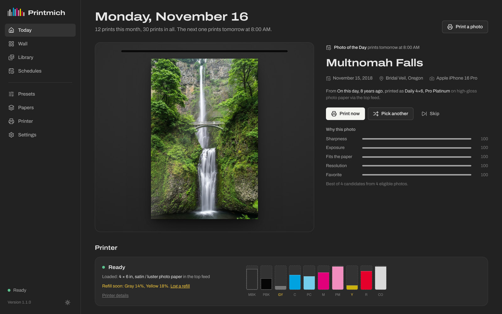<br><sub>Today: what prints next, why it was picked, and the printer's ink and paper</sub></td>
    <td width="50%">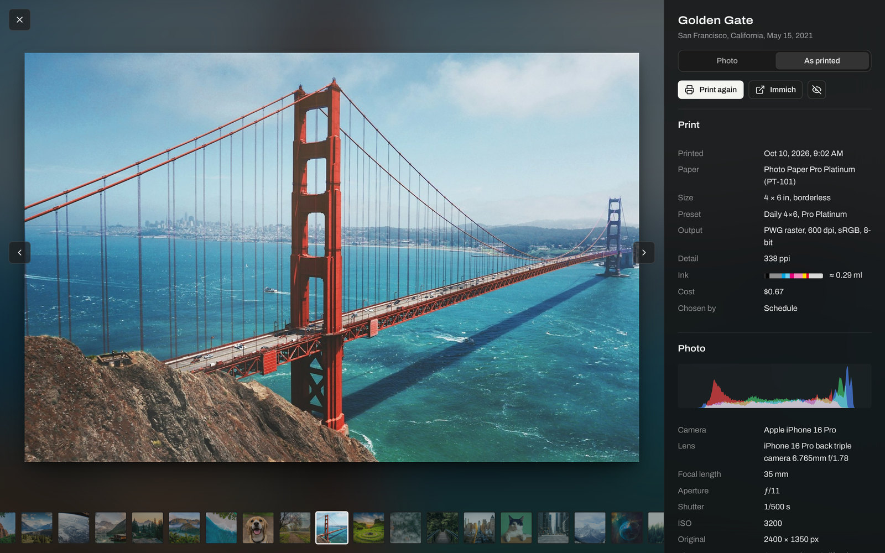<br><sub>Viewer: any print as it came out of the printer, with its settings</sub></td>
  </tr>
  <tr>
    <td>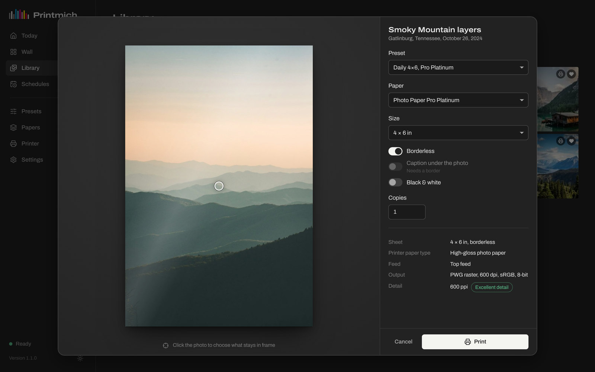<br><sub>Print any photo from your library with a live page preview</sub></td>
    <td>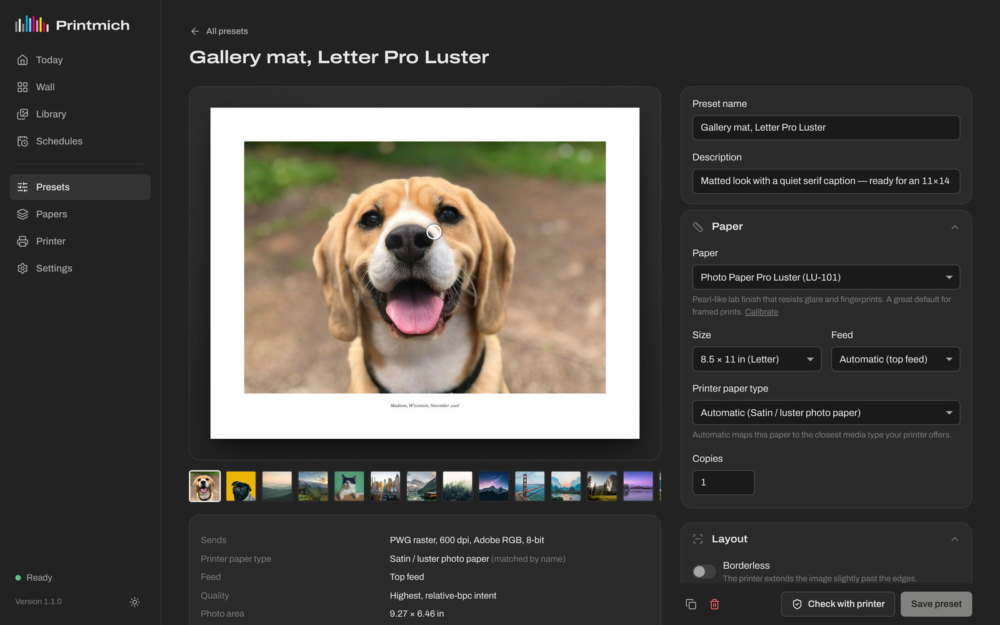<br><sub>Presets: paper, layout, caption, color and quality in one place</sub></td>
  </tr>
  <tr>
    <td>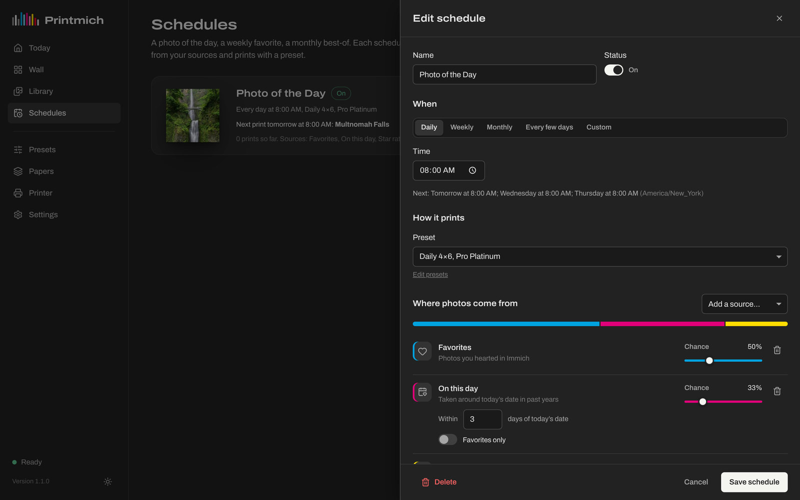<br><sub>Schedules: when to print and where photos come from</sub></td>
    <td>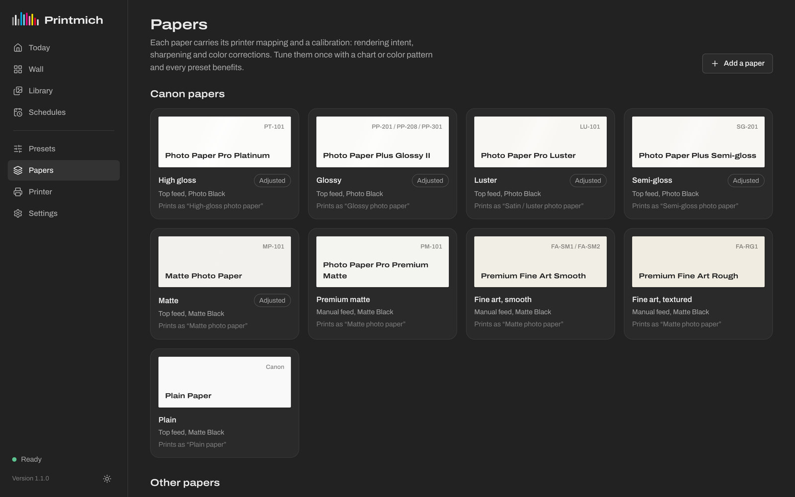<br><sub>Papers: Canon stocks with calibration tools</sub></td>
  </tr>
  <tr>
    <td>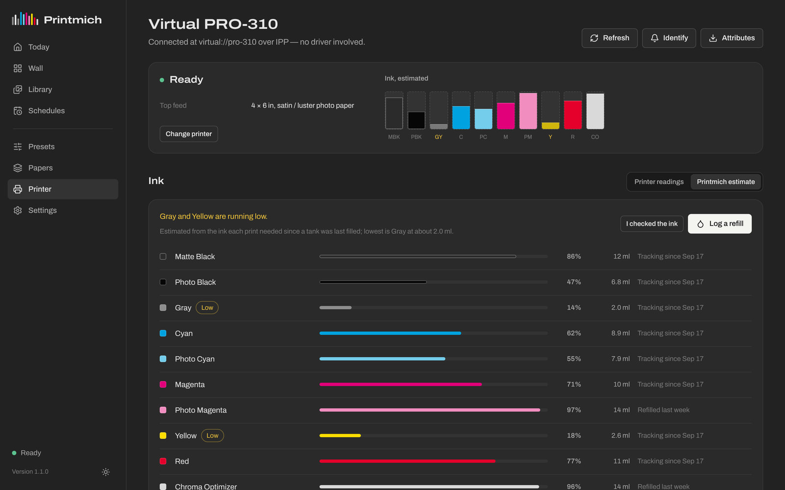<br><sub>Printer: status, ink and everything the printer reports it can do</sub></td>
    <td>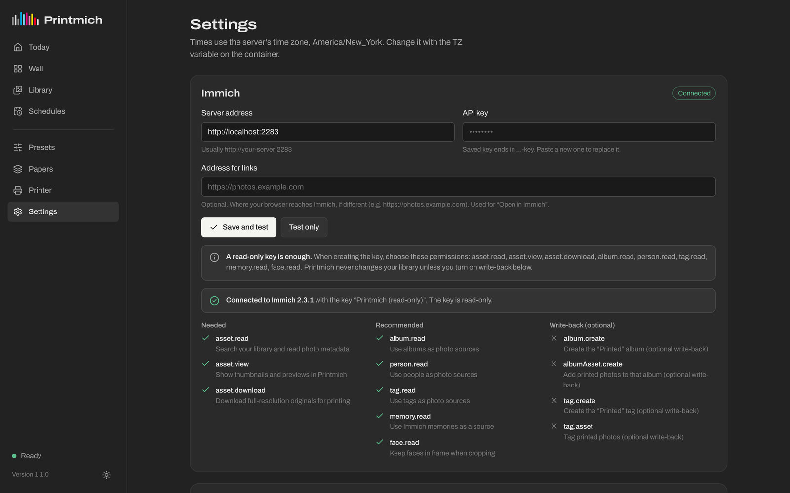<br><sub>Settings: Immich connection with a permission check</sub></td>
  </tr>
</table>

<table>
  <tr>
    <td width="25%">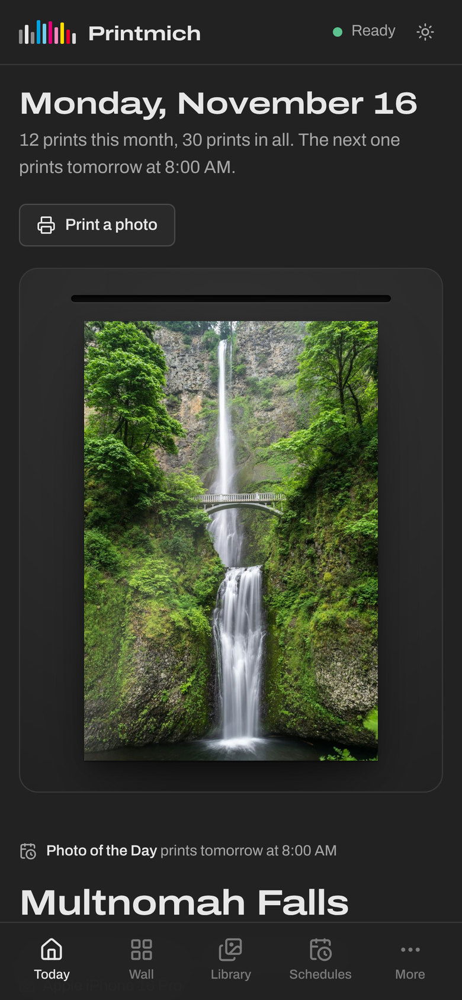</td>
    <td width="25%">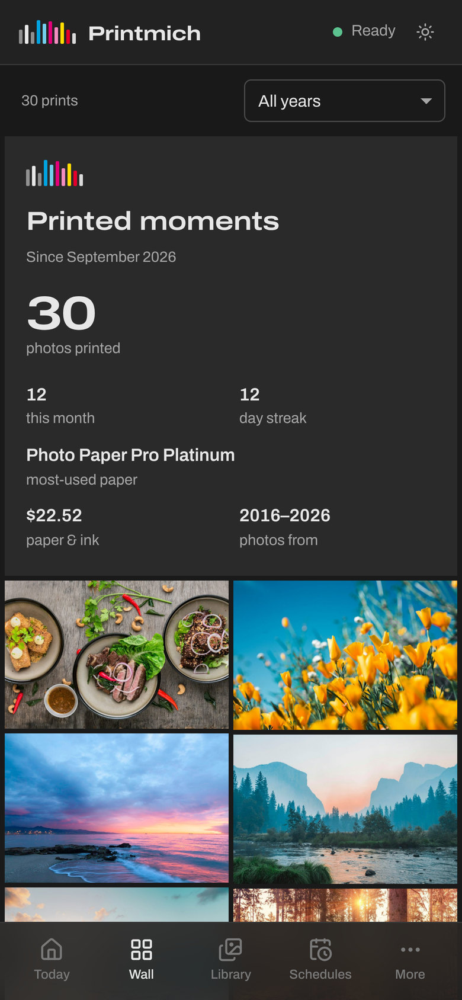</td>
    <td width="25%">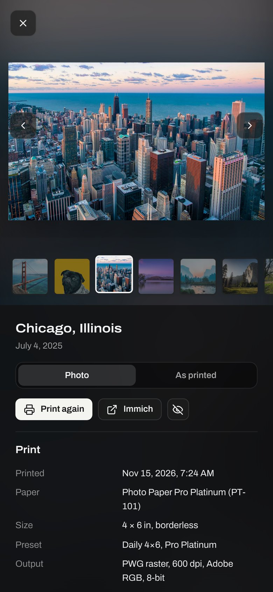</td>
    <td width="25%">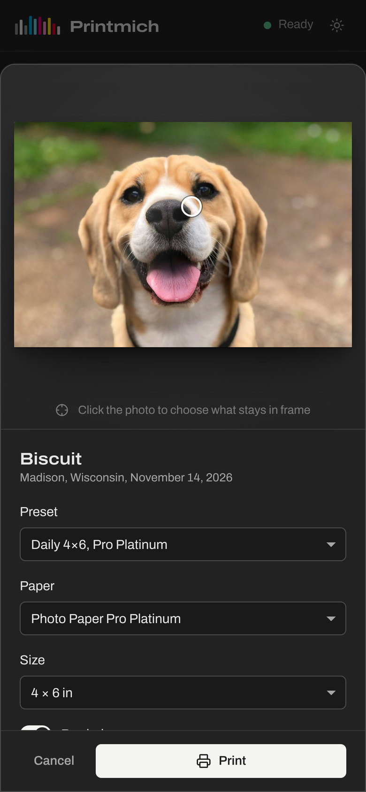</td>
  </tr>
</table>

There is a light theme too:

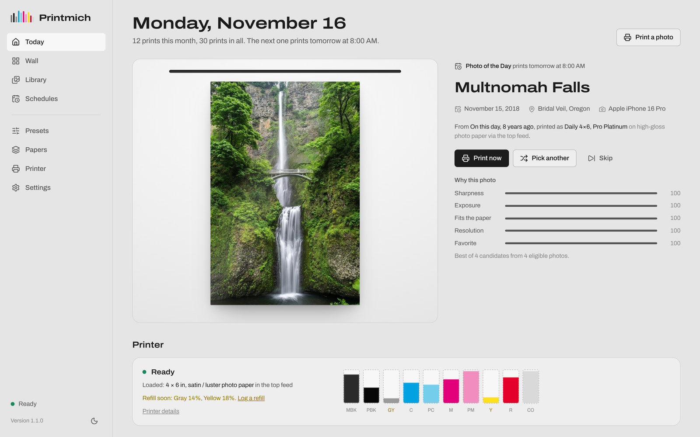

## Install on Unraid

1. Open a terminal on Unraid and add the template:

   ```sh
   wget -O /boot/config/plugins/dockerMan/templates-user/my-Printmich.xml \
     https://raw.githubusercontent.com/au12/Printmich/main/unraid/printmich.xml
   ```

2. Go to **Docker → Add Container**, choose **Printmich** from the template list, and apply. The defaults put the web UI on port **2284** and your data in `/mnt/user/appdata/printmich`.
3. Open the web UI. Connect Immich and the printer in the app, or fill in the template's variables ahead of time.

**Networking.** Bridge mode works when you enter the printer's IP address. If you'd like Printmich to find printers on its own (mDNS/Bonjour), set the container's network to **br0** or **host**.

## Docker Compose

```yaml
services:
  printmich:
    image: ghcr.io/au12/printmich:latest
    container_name: printmich
    ports:
      - "2284:8080"
    volumes:
      - ./printmich:/config
    environment:
      TZ: America/New_York
      # All optional; anything set here is locked in the web UI.
      IMMICH_URL: http://immich-server:2283
      IMMICH_API_KEY: your-read-only-key
      PRINTER_URI: ipp://192.168.1.50/ipp/print
    restart: unless-stopped
```

Images are published for `linux/amd64` and `linux/arm64`.

## Set up

### 1. An Immich API key

In Immich, open **Account Settings → API Keys → New API Key** and choose only these permissions:

| Permission | Why |
| --- | --- |
| `asset.read` | Search your library and read photo metadata (required) |
| `asset.view` | Thumbnails and previews (required) |
| `asset.download` | Full-resolution originals for printing (required) |
| `album.read`, `person.read`, `tag.read`, `memory.read` | Albums, people, tags and memories as photo sources |
| `face.read` | Keep faces in frame when cropping |

That key cannot change anything in your library. If you'd like printed photos added to a "Printed" album or tag, turn on **Settings → Write back to Immich** and add `album.create`, `albumAsset.create`, `tag.create` and `tag.asset`. Settings shows which permissions the key has.

Immich v1.135 or newer is recommended; older servers work with reduced album filtering.

### 2. The printer

On the **Printer** page, enter the printer's IP address (for example `192.168.1.50`) or pick it from the discovered list. Printmich fills in the rest (`ipp://192.168.1.50:631/ipp/print`). Give the printer a DHCP reservation so the address doesn't change.

Printmich reads the printer's own list of sizes, media types, feeds, margins and color spaces, so menus only offer what your printer accepts. **Check with printer** on any preset asks the printer to validate the job without printing.

A few PRO-310 settings are stored on the printer per paper type and aren't part of IPP: drying time, print head height (abrasion prevention), the borderless extension amount and similar. Set those once on the printer's panel or in Canon's Remote UI.

### 3. Presets and papers

Presets describe how a print comes out: paper, size, borders or mat, caption, color and quality. Six are included (a daily 4×6, an instant-frame 4×6 with a caption strip, 5×7, a matted Letter print, black-and-white on matte, and a 13×19 exhibition print). Duplicate one to make your own.

Each paper carries a calibration that every preset using it inherits:

1. **Print a calibration chart** from the paper's page. Compare the gray wedge, color patches and shadow steps with your (calibrated) screen.
2. **Adjust** brightness, contrast, shadows, highlights and cyan/magenta/yellow balance for that paper.
3. **Print a color pattern** if you're unsure which way to go: one of your photos in a grid of variations, like Canon's pattern print. Pick the best tile and apply it.
4. **For measured color**, print a profiling target with color management off, build an ICC profile with your measurement device, and upload it. Presets can then use the custom profile.

### 4. Refilled or third-party ink (optional)

A Canon tank's chip counts the ink it shipped with, not what's in it. When you install a tank that has run empty before, such as a refilled one, the PRO-310 stops with **support code 1699** until you **hold its Stop button for 5 seconds**. Canon only offers this as a button press on the printer, and IPP has no command for it, so Printmich can't do it for you. The printer remembers it for that tank, so expect it once per tank rather than at every print. After that, the printer stops tracking that tank and won't warn you before it runs dry.

Printmich covers both halves:

- If a print stops at the printer, Printmich keeps the job, sends you a notification saying what to do, and the print finishes on its own once the printer is ready. Nothing is lost or reprinted.
- On **Printer → Ink**, switch to **Printmich estimate** and start from the printer's last readings or from full tanks. Each print's ink is estimated from the finished page (light and dark inks, gray and black for neutrals, red, chroma optimizer on glossy paper, plus each tank's share of head cleaning), and the tanks count down from there.
- **Log a refill** when you top up. If you enter how much ink went in (syringe marks, or weigh the tank before and after; 1 g is about 1 ml), Printmich compares it with its estimate and corrects that tank from then on.
- You get a reminder when a tank drops below a level you choose, and optionally every few days. Scheduled prints wait when a tank is nearly empty; release one from the queue to print it anyway.

The estimate starts from Canon's published PRO-310 yields, which assume continuous printing. A print every day or two spends more ink on cleaning, so early estimates may run optimistic until you've logged a measured refill or two.

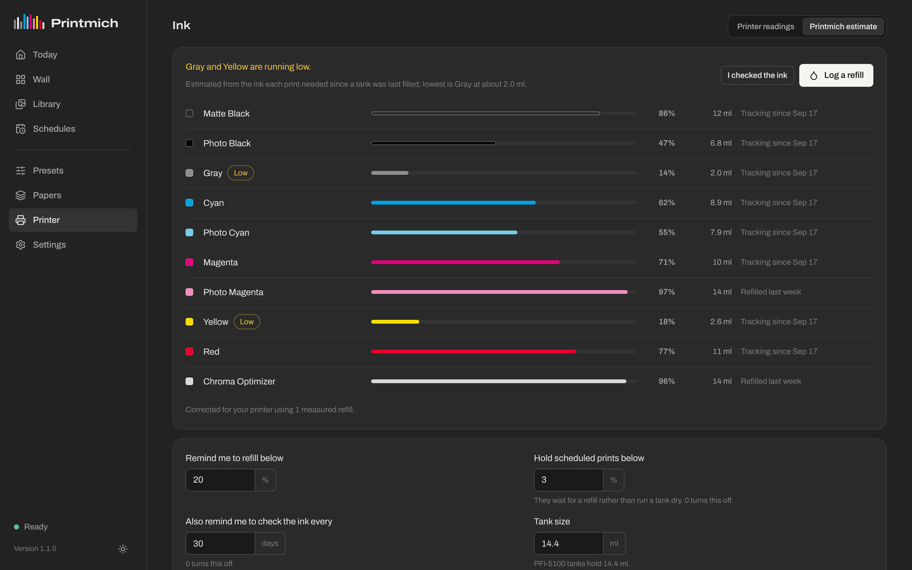

### 5. A schedule

The included **Photo of the Day** schedule is off until you turn it on. Choose:

- **When**: daily, weekly, monthly, every few days or cron, at a time in your time zone (`TZ`).
- **Where photos come from**: favorites, albums, people, tags, star ratings, smart search, Immich memories, on this day, recent or random, each with a weight.
- **Rules**: skip photos printed in the last year, skip screenshots and blurry photos, require enough resolution for the print size, prefer an orientation, exclude albums.
- **Approval**: print automatically, preview the pick ahead of time (you can swap or skip it), or wait for approval.
- **Paper check**: hold the print if the loaded paper doesn't match the preset.

## Configuration

| Variable | Default | |
| --- | --- | --- |
| `IMMICH_URL` | | Immich server address, e.g. `http://192.168.1.10:2283` |
| `IMMICH_API_KEY` | | Immich API key |
| `IMMICH_PUBLIC_URL` | | Address your browser uses for Immich, for "Open in Immich" links |
| `PRINTER_URI` | | Printer address. `virtual://pro-310` uses the virtual printer |
| `PRINTMICH_PASSWORD` | | Password for the web UI and API. Empty means no login |
| `PRINTMICH_PUBLIC_URL` | | Printmich's own address, added to notifications |
| `TZ` | `Etc/UTC` | Time zone for schedules (Unraid sets this for you) |
| `PUID` / `PGID` | `99` / `100` | User and group the app runs as |
| `UMASK` | `002` | File mode mask for files in `/config` |
| `PRINTMICH_PORT` | `8080` | Port inside the container |
| `PRINTMICH_LOG_LEVEL` | `info` | `debug`, `info`, `warning` or `error` |

Everything else lives in the web UI and is stored in `/config/printmich.db`. **Settings → Backup** exports and imports settings, presets, papers and schedules as JSON (passwords and keys are left out).

## API

Every screen is built on a JSON API, documented at `/api/docs`. With a password set, create an API token in **Settings → Security** and send it as `Authorization: Bearer <token>`. For example, to have a schedule print right now from a Home Assistant automation:

```sh
curl -X POST -H "Authorization: Bearer $TOKEN" http://unraid:2284/api/schedules/<schedule-id>/run
```

## How it works

```
Immich ──(read-only API)──▶ picker ──▶ renderer ───────────────────────▶ printer
                            sources     crop, resize, color-manage,      IPP Print-Job
                            scoring     adjust, sharpen, lay out,        PWG raster or JPEG
                                        caption, encode                  status and ink via IPP
```

- The renderer is built on [libvips](https://www.libvips.org/), streaming even 13×19 pages at 600 dpi in modest memory. It decodes HEIC, AVIF, JPEG XL, PNG, TIFF and WebP originals; for RAW files it falls back to Immich's full-size preview.
- Pages are sent as PWG raster (the format AirPrint-class printers render natively) with the exact media size, type, feed, margins, quality and resolution, or as JPEG for printers that prefer it.
- Color is converted from the photo's embedded profile to sRGB or Adobe RGB with your chosen rendering intent. Wide-gamut photos (such as iPhone Display P3) automatically go out as Adobe RGB unless you choose otherwise.

## Development

```sh
# backend (Python 3.12+, libvips)
cd backend
pip install -r requirements-dev.txt
PRINTMICH_DATA=/tmp/pm PRINTER_URI=virtual://pro-310 python -m printmich.main

# frontend (Node 22)
cd frontend
npm install
npm run dev        # proxies /api to :8080

# tests and lint
cd backend && pytest && ruff check .
```

`dev/` has a mock Immich server with a demo library, a script that seeds a believable print history, and the screenshot script used for this README:

```sh
python dev/demo_photos.py /tmp/demo/lib
MOCK_LIB=/tmp/demo/lib uvicorn mock_immich:app --port 2283 --app-dir dev
python dev/seed_demo.py http://localhost:8080 /tmp/pm/printmich.db
python dev/screenshots.py http://localhost:8080 docs/images
```

Printer quirks are easiest to fix with the printer's own attribute list: **Printer → Attributes** downloads it as JSON. Please attach it to issues about a specific printer.

## Credits

- Photo wall inspired by [ChronoFrame](https://github.com/HoshinoSuzumi/chronoframe).
- Demo photos in the screenshots are from [Unsplash](https://unsplash.com/license).
- Built on [Immich](https://immich.app), [libvips](https://www.libvips.org/), [FastAPI](https://fastapi.tiangolo.com/), [React](https://react.dev/) and [Apprise](https://github.com/caronc/apprise). Typefaces: [Archivo](https://fonts.google.com/specimen/Archivo), [EB Garamond](https://github.com/octaviopardo/EBGaramond12) and [Inter](https://rsms.me/inter/).

Printmich is not affiliated with Canon or Immich. Canon and imagePROGRAF are trademarks of Canon Inc.

## License

[MIT](LICENSE)
